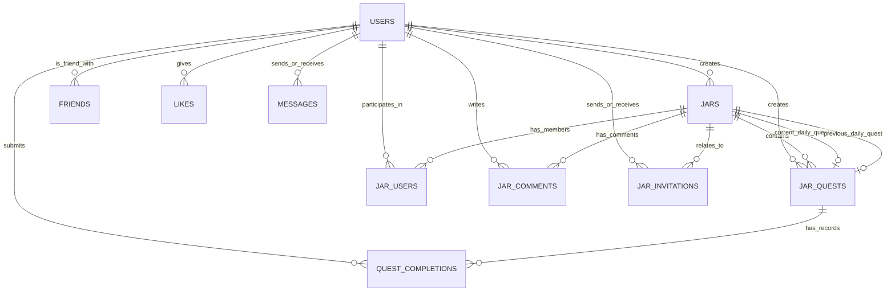

# SideQuestJar Database Plan

This document outlines the database schema for the SideQuestJar application, based on the provided `sidequestjar.sql` dump. It includes an Entity-Relationship (ER) diagram and detailed table structures to provide a clear understanding of the data model.

## Entity-Relationship Diagram

## Table Definitions

### Core Entities

#### `users`
Stores user account information and profile details.

| Column | Type | Constraints / Defaults | Description |
|---|---|---|---|
| `id` | bigint(20) UNSIGNED | PRIMARY KEY, AUTO_INCREMENT | Unique identifier |
| `username` | varchar(255) | UNIQUE, NOT NULL | Login username |
| `email` | varchar(255) | UNIQUE, NOT NULL | User email address |
| `password` | varchar(255) | NOT NULL | Hashed password |
| `nickname` | varchar(255) | DEFAULT NULL | Display nickname |
| `fullname` | varchar(255) | NOT NULL | User's full name |
| `profile_picture` | varchar(255) | DEFAULT 'images/default-avatar.png' | Avatar path |
| `birth_date` | date | NOT NULL | Date of birth |
| `joined_date` | datetime | DEFAULT NULL | When they fully joined/verified |
| `user_xp` | int(11) | DEFAULT 0 | Accumulated experience points |
| `is_customized` | tinyint(1) | DEFAULT 0 | Profile customized flag |
| `is_admin` | tinyint(1) | DEFAULT 0 | Admin privilege flag |

#### `jars`
Groups (Jars) that contain quests and users.

| Column | Type | Constraints / Defaults | Description |
|---|---|---|---|
| `id` | bigint(20) UNSIGNED | PRIMARY KEY, AUTO_INCREMENT | Unique identifier |
| `name` | varchar(255) | NOT NULL | Jar name |
| `description` | longtext | DEFAULT NULL | Detailed description |
| `type` | enum | DEFAULT 'public_jar' | Privacy level (public, private, etc.) |
| `created_by` | bigint(20) UNSIGNED | FOREIGN KEY (users.id) | Creator of the jar |
| `picture` | varchar(255) | DEFAULT 'images/default-jar.png' | Jar image |
| `current_daily_quest_id` | bigint(20) UNSIGNED | FOREIGN KEY (jar_quests.id) | Active daily quest |
| `previous_daily_quest_id` | bigint(20) UNSIGNED | FOREIGN KEY (jar_quests.id) | Yesterday's daily quest |
| `current_daily_quest_date` | date | DEFAULT NULL | Date of the current quest |

#### `jar_quests`
Individual tasks/quests within a Jar.

| Column | Type | Constraints / Defaults | Description |
|---|---|---|---|
| `id` | bigint(20) UNSIGNED | PRIMARY KEY, AUTO_INCREMENT | Unique identifier |
| `jar_id` | bigint(20) UNSIGNED | FOREIGN KEY (jars.id) | Jar this quest belongs to |
| `title` | varchar(255) | NOT NULL | Quest title |
| `description` | longtext | DEFAULT NULL | Task details |
| `picture` | varchar(255) | DEFAULT 'images/default-quest.png'| Quest image |
| `completions` | int(11) | DEFAULT 0 | Total number of times completed |
| `xp_gain` | int(11) | DEFAULT NULL | XP rewarded upon completion |
| `created_by` | bigint(20) UNSIGNED | FOREIGN KEY (users.id) | User who added the quest |

#### `quest_completions`
Records of when a user completes a specific quest.

| Column | Type | Constraints / Defaults | Description |
|---|---|---|---|
| `id` | bigint(20) UNSIGNED | PRIMARY KEY, AUTO_INCREMENT | Unique identifier |
| `user_id` | bigint(20) UNSIGNED | FOREIGN KEY (users.id) | User who completed it |
| `jar_quest_id` | bigint(20) UNSIGNED | FOREIGN KEY (jar_quests.id) | Completed quest |
| `completion_date`| datetime | NOT NULL | When it was completed |
| `picture` | varchar(255) | DEFAULT '' | Proof picture |
| `description` | longtext | DEFAULT NULL | User's note on completion |
| `type` | enum | DEFAULT 'public_post' | Privacy of the completion post |

### Relational & Social Entities

#### `jar_users`
Pivot table linking users to the jars they have joined.

| Column | Type | Constraints / Defaults | Description |
|---|---|---|---|
| `id` | bigint(20) UNSIGNED | PRIMARY KEY, AUTO_INCREMENT | Unique identifier |
| `jar_id` | bigint(20) UNSIGNED | FOREIGN KEY (jars.id) | The Jar |
| `user_id` | bigint(20) UNSIGNED | FOREIGN KEY (users.id) | The User |
| `streak` | int(11) | DEFAULT 0 | User's active streak in this jar |

#### `friends`
Manages friendship connections between users.

| Column | Type | Constraints / Defaults | Description |
|---|---|---|---|
| `id` | bigint(20) UNSIGNED | PRIMARY KEY, AUTO_INCREMENT | Unique identifier |
| `user_id` | bigint(20) UNSIGNED | FOREIGN KEY (users.id) | Initiator user |
| `friend_id` | bigint(20) UNSIGNED | FOREIGN KEY (users.id) | Target user |
| `status` | enum | DEFAULT 'pending' | 'pending' or 'accepted' |

#### `jar_invitations`
Invitations sent to users to join specific jars.

| Column | Type | Constraints / Defaults | Description |
|---|---|---|---|
| `id` | bigint(20) UNSIGNED | PRIMARY KEY, AUTO_INCREMENT | Unique identifier |
| `jar_id` | bigint(20) UNSIGNED | FOREIGN KEY (jars.id) | Target Jar |
| `inviter_id` | bigint(20) UNSIGNED | FOREIGN KEY (users.id) | Inviting user |
| `invitee_id` | bigint(20) UNSIGNED | FOREIGN KEY (users.id) | Invited user |
| `status` | enum | DEFAULT 'pending' | 'pending', 'accepted', 'declined' |

#### `jar_comments`
Comments posted within a jar.

| Column | Type | Constraints / Defaults | Description |
|---|---|---|---|
| `id` | bigint(20) UNSIGNED | PRIMARY KEY, AUTO_INCREMENT | Unique identifier |
| `jar_id` | bigint(20) UNSIGNED | FOREIGN KEY (jars.id) | Jar where comment is posted |
| `user_id` | bigint(20) UNSIGNED | FOREIGN KEY (users.id) | Comment author |
| `content` | text | NOT NULL | The text content |

#### `likes`
Polymorphic table allowing users to "like" various entities (e.g., completions, comments).

| Column | Type | Constraints / Defaults | Description |
|---|---|---|---|
| `id` | bigint(20) UNSIGNED | PRIMARY KEY, AUTO_INCREMENT | Unique identifier |
| `user_id` | bigint(20) UNSIGNED | FOREIGN KEY (users.id) | User giving the like |
| `likeable_type` | varchar(255) | NOT NULL | Model class name (Polymorphic) |
| `likeable_id` | bigint(20) UNSIGNED | NOT NULL | Target entity ID (Polymorphic) |

#### `messages`
Direct chat messages between users.

| Column | Type | Constraints / Defaults | Description |
|---|---|---|---|
| `id` | bigint(20) UNSIGNED | PRIMARY KEY, AUTO_INCREMENT | Unique identifier |
| `sender_id` | bigint(20) UNSIGNED | FOREIGN KEY (users.id) | Message sender |
| `receiver_id` | bigint(20) UNSIGNED | FOREIGN KEY (users.id) | Message receiver |
| `content` | text | NOT NULL | Message body |
| `read_at` | timestamp | DEFAULT NULL | Read receipt timestamp |

### System Tables
The database also includes several standard Laravel system tables:
- `cache` / `cache_locks`: Cache management
- `failed_jobs` / `jobs` / `job_batches`: Queue system
- `migrations`: Track database migrations
- `password_reset_tokens`: Password recovery
- `personal_access_tokens`: API authentication
- `sessions`: User session tracking
